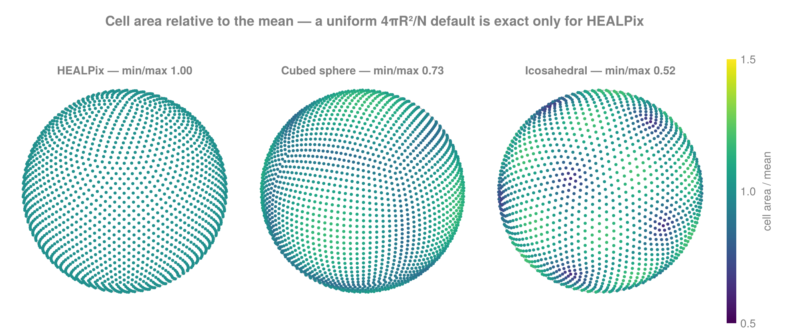
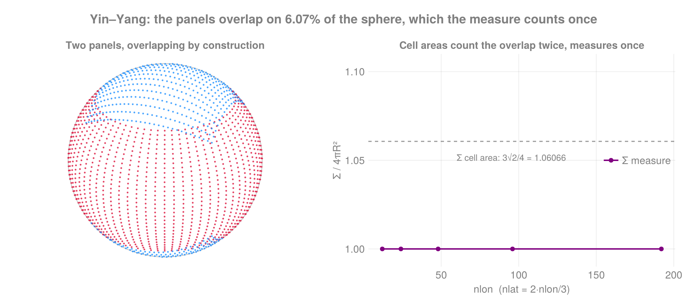

```@meta
CurrentModule = FlowGeometries.Grids
```

```@setup grids
using FlowGeometries: FlowGeometries as FG
geo    = FG.Geometry.SphericalGeometry()
ax     = FG.SphericalSampling.spherical_axes(FG.SphericalSampling.Fejer1Sampling(), 32)
λaxis, φaxis = ax.λ, ax.φ
mask   = trues(length(λaxis), length(φaxis))
grid   = FG.Grids.StructuredGrid(geo, λaxis, φaxis, mask; topology = FG.Grids.Periodic())
λ2d    = [λaxis[i] for i in eachindex(λaxis), j in eachindex(φaxis)]
φ2d    = [φaxis[j] for i in eachindex(λaxis), j in eachindex(φaxis)]
λc, φc = FG.Grids._centers_to_corners(λ2d), FG.Grids._centers_to_corners(φ2d)
cg     = FG.Grids.CurvilinearGrid(geo, λ2d, φ2d, mask)
I      = (3, 5)
i, j   = 3, 5
```

# [Grids](@id grids-page)

A grid answers: **how is the data stored?** It pairs a geometry with coordinates, a per-cell measure
and an activity mask.

| type | coordinates | use |
|---|---|---|
| `StructuredGrid` | one 1-D axis per direction | rectilinear: lat–lon, any tensor-product sampling |
| `CurvilinearGrid` | one `N`-D array per direction | logically rectangular, geometrically warped |
| `HEALPixGrid` | none — `(nside, pixel)` arithmetic | the HEALPix pixelization |
| `CubedSphereGrid` | none — `(n, cell)` arithmetic | the gnomonic cubed sphere |
| `YinYangGrid` | none — `(nlon, nlat, cell)` arithmetic | Kageyama–Sato overset panels |
| `IcosahedralGrid` | none — `(ν, id)` arithmetic | geodesic, 12 pentagons |
| `RingGrid` | one value per *ring* | reduced Gaussian, octahedral |
| `UnstructuredGrid` | one value per node, plus CSR neighbours | scattered points, an arbitrary mesh |
| `RotatedGrid` | its base grid's, reported in another frame | a rotated-pole lat–lon mesh |

The first two store coordinates because a warped mesh's are arbitrary, and `UnstructuredGrid` stores
them because a node set's are the caller's. The five in between store none, or one value per ring: a
cell's position and its neighbours are closed-form in the layout's parameters, so they hold those
parameters instead. A `RotatedGrid` holds a rectilinear grid and a pole rotation, and evaluates each
cell's position in the other frame; see [Geometry](@ref geometry-page). `HEALPixGrid` is the same size at `nside = 1024` — 12.6 million pixels — as at `nside = 1`. Ask
for the dense cloud with [`Grids.materialize`](@ref) when something outside needs it.

## Building one

```@example grids
using FlowGeometries: FlowGeometries as FG

# From a sampling — the usual route
grid = FG.Connectivity.structured_grid(FG.SphericalSampling.Fejer1Sampling(), 64)
g    = FG.Grids.HEALPixGrid(16)
rg   = FG.Grids.RingGrid(FG.SphericalSampling.OctahedralGaussianSampling(64))
cs   = FG.Grids.CubedSphereGrid(24)
yy   = FG.Grids.YinYangGrid(32, 22)
ico  = FG.Grids.IcosahedralGrid(16)

# Or directly, in any number of dimensions; the mask is optional
sg  = FG.Grids.StructuredGrid(FG.Geometry.SphericalGeometry(), λaxis, φaxis, mask; topology = FG.Grids.Periodic())
cg  = FG.Grids.CurvilinearGrid(FG.Geometry.SphericalGeometry(), λ2d, φ2d, mask; topology = FG.Grids.Periodic())
g4  = FG.Grids.StructuredGrid(FG.Geometry.CartesianGeometry(),
                              0:1.0:3, 0:1.0:3, 0:1.0:3, 0:1.0:3)  # 4-D, all active
size(g4)
```

A direction wraps when its axis type says so — a [`PeriodicAxis`](@ref FlowGeometries.Axes.PeriodicAxis),
`n` equal cells around one period, as a sampling's longitude is — or when `topology` names it
[`Periodic`](@ref). Every other direction is bounded; nothing is read off the coordinate values. On a periodic axis
the seam is one step wide by construction, so its widths, faces and stencil rows keep their uniform
forms; a plain axis declared periodic takes the per-cell forms, which hold whatever seam its period
leaves.

```@example grids
wrapped = FG.Grids.StructuredGrid(FG.Geometry.SphericalGeometry(), FG.Axes.PeriodicAxis(0.0, 2π, 64), φaxis)
FG.Grids.isperiodic(wrapped, 1), FG.Grids.isperiodic(FG.Grids.StructuredGrid(geo, λaxis, φaxis), 1)
```

A formula layout answers every per-cell question by arithmetic. HEALPix's storage does not depend on its
resolution; the cubed sphere and the icosahedral geodesic hold their cell areas besides, a quadrant of one
panel and one area per symmetry class of vertex, and Yin–Yang one panel's cell measures, which both
panels share.

```@example grids
FG.Grids.coords(g, 100), FG.Grids.measure(g, 100), collect(FG.Grids.neighbors(g, 100))
```

```@example grids
λ, φ = FG.Grids.materialize(g)                     # the dense cloud, asked for explicitly
length(λ)
```

## The common interface

Everything below works on every architecture:

```@example grids
out = zeros(2)
FG.Grids.coords(grid, i, j)                        # (λ = …, φ = …) or (x = …, y = …)
FG.Grids.coords!(out, grid, i, j)                  # into your buffer
FG.Grids.coords(NTuple{2,Float64}, grid, i, j)     # a specific storage type
FG.Grids.measure(grid, i, j)                       # cell area / volume / control-volume size
FG.Grids.isactive(grid, i, j)                      # participates in the domain?
collect(FG.Grids.neighbors(grid, i, j))            # lazy iterator over neighbour indices
size(grid), length(grid), FG.Grids.size_tuple(grid)
FG.Grids.isperiodic(grid, 1), FG.Grids.period(grid, 1)
```

Coordinates are also reachable by their geometry-correct names — `grid.λ`, `grid.φ` on a sphere;
`grid.x`, `grid.y` on a plane.

## Cell measure is stored factored

On a rectilinear grid every measure this package supports is a product of one factor per axis:
Cartesian `Δx·Δy·Δz`, spherical `(Δλ)·(R²(sin φ₊ − sin φ₋))`, the exact area between a cell's faces
with the outer latitude faces clamped to the poles, so the cells of a global grid sum to `4πR²`. A grid
built on a sampling with quadrature weights (Gauss–Legendre, Driscoll–Healy, Fejér first rule) takes
`R²·wⱼ` as its latitude factor, and `sum(f .* measure(grid))` is that quadrature. A `StructuredGrid`
stores those `∑ Nᵈ` factors, and the `∏ Nᵈ` products come out of them.

```@example grids
m = FG.Grids.measure(grid)           # a SeparableMeasure — a real AbstractArray
m[3, 5]                        # indexes exactly like the dense outer product
sum(m)                         # ∏ᵈ ∑ᵢ wᵈᵢ — O(∑ Nᵈ) against the dense O(∏ Nᵈ)
FG.Grids.measure_factors(grid)       # the per-axis factors, or `nothing`
FG.Grids.measure_array(grid)         # materialize densely, if you really need it
```

Indexing, broadcasting and `collect` behave exactly as for the dense array, and the values are
bit-identical. At 4000 × 2000 the measure is **0.046 MiB** against 61.0 MiB dense, and *faster* to read on
every access pattern measured: the factors stay in cache while a 61 MiB array is DRAM-bound. See
[Performance](@ref performance-page).

Operations that keep the measure a *product* stay factored, so a unit conversion does not undo the
saving: scaling by any real number, a multiplicative map (`abs`, `abs2`, `sqrt`, `inv`), and a
factor-wise product or quotient of two measures.

```@example grids
km² = m ./ 1e6
typeof(km²).name.name
```

Anything else materializes, correct and dense. `exp` is the clean example: it is not multiplicative, so
`exp(∏wᵈ) ≠ ∏exp(wᵈ)` and there is no factored form to keep.

```@example grids
typeof(exp.(m)).name.name, typeof((-1.0) .* m).name.name
```

`sum` being O(∑Nᵈ) is also what stops `show` from adding eight million numbers to print one line.

## Masks

```@example grids
FG.Grids.mask(grid)                  # the mask array
FG.Grids.isactive(grid, i, j)        # false = excluded (land, say)
```

When every cell participates the mask is `AllActive`, which stores its size and nothing else —
`getindex` folds to a constant and `count` is `length` without a scan. Pass a real `BitArray` or
`Array{Bool}` when you need to exclude cells.

## Curvilinear corners

`CurvilinearGrid`'s exact quadrilateral cell area comes from its cell vertices — the spherical excess of
the two triangles through the four corner directions on a sphere, the shoelace area on a plane.

```@example grids
cg2 = FG.Grids.CurvilinearGrid(geo, λ2d, φ2d, mask; corners = (λc, φc))
size(FG.Grids.corners(cg2, 1)), FG.Grids.corner_coords(cg2, i, j)
```

Supply `corners` when your source model ships its own cell-vertex grid; otherwise they
are reconstructed from the centres, which needs at least a 2×2 grid.

Vertices you supply are kept on the grid. Reconstructed ones are input to the area kernel, and are kept
only if you ask — one array per direction, one larger in every direction:

```@example grids
lean = FG.Grids.CurvilinearGrid(geo, λ2d, φ2d, mask)
full = FG.Grids.CurvilinearGrid(geo, λ2d, φ2d, mask; keep_corners = true)
FG.Grids.has_corners(lean), FG.Grids.has_corners(full)
```

A curvilinear grid takes any number of directions — one `N`-D array each, `mask` last. Beyond 2-D the
cell measure is yours to pass: the corner-area kernel is an exact-quadrilateral algorithm with no N-D
generalization here, so asking it for a 3-D measure raises.

```@example grids
cart = FG.Geometry.CartesianGeometry()
X = [x for x in 0.0:1.0:3.0, _ in 1:3, _ in 1:2]
Y = [y for _ in 1:4, y in 0.0:2.0:4.0, _ in 1:2]
Z = [z for _ in 1:4, _ in 1:3, z in 0.0:0.5:0.5]
cg3 = FG.Grids.CurvilinearGrid(cart, X, Y, Z, fill(1.0, 4, 3, 2), trues(4, 3, 2))
size(cg3), FG.Grids.coordinate_names(cg3), FG.Grids.coords(cg3, 2, 3, 2)
```

The measure goes either before the mask, as above, or as the `measure` keyword:

```@example grids
FG.Grids.CurvilinearGrid(cart, X, Y, Z, trues(4, 3, 2); measure = fill(1.0, 4, 3, 2));
```

Node grids generalize the same way, with the coordinates as a tuple — a run of vectors cannot say how
many of them are coordinates, where a curvilinear grid counts them from `ndims(mask)`:

```@example grids
nodes = FG.Grids.UnstructuredGrid(cart, (rand(6), rand(6), rand(6)), ones(6), trues(6))
FG.Grids.coordinate_names(nodes), FG.Grids.coords(nodes, 4)
```

## Cell areas on the spherical node sets

Cell areas are an exact closed form, dispatched on the sampling — never a uniform `4πR²/N` fallback,
which is right only for equal-area samplings and silently wrong elsewhere (icosahedral dual cells span
a min/max ratio of 0.52).

| layout / sampling | cell areas |
|---|---|
| `HEALPixGrid` | uniform `4πR²/N` — exact by construction, and stored as one number |
| `CubedSphereGrid` | exact solid angle of the cell's own gnomonic rectangle |
| `YinYangGrid` | lat–lon patch area `R²Δλ·2sin(Δφ/2)·cosφ`, less half its overlap with the other panel |
| `RingGrid` | `R²·(2π/nlonᵣ)·wᵣ` from the ring's Gaussian weight |
| `IcosahedralGrid` | the spherical Voronoi dual, from the vertex's own incident triangles |
| arbitrary points | Voronoi areas, via the Quickhull or DelaunayTriangulation extension |



Only HEALPix is one flat colour. The dark spots on the icosahedral panel are its twelve pentagons —
the smallest cells on the mesh, and the reason a uniform default is off by nearly a factor of two
between the largest and smallest cell there.

Every layout's measures sum to `4πR²` to machine precision and need no optional dependency. On the
node sets, pass `areas = …` to supply your own.



!!! note "Yin–Yang panels overlap"
    The two panels overlap by construction, so their cell areas sum to `3√2πR²`, 6.07% more than the
    sphere at every resolution. A cell's measure is its area less half the part of it the other panel
    also covers, that overlap integrated in closed form, so `sum(f .* measure(grid))` counts every point
    of the sphere once.
